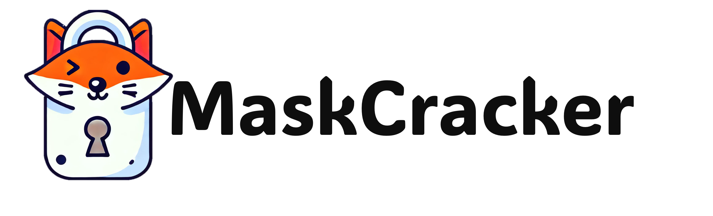
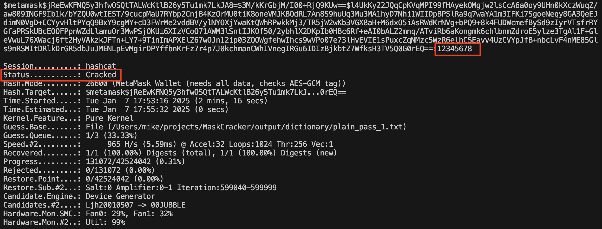

<div align="center">

</div>
<p align="center">
  <a href="./README_zh.md">中文</a> 
</p>

# MaskCracker: Is Your Metamask Wallet Secure?

MaskCracker is a security assessment tool designed to evaluate the safety of your Metamask wallet in the following scenarios:
1. When all website passwords in your browser are compromised
2. When you accidentally run malicious code

## How It Works

MaskCracker can:
- Export passwords from Chrome browser
- Use AI models to analyze password patterns and generate highly probable password dictionaries
- Combine password libraries with [Hashcat](https://hashcat.net/hashcat), the world's fastest password recovery tool, to crack Metamask seed phrases or private keys

> **Disclaimer**: This tool is for security research purposes only. Users assume all legal responsibility for the use of this tool. The author bears no legal liability.

## Installation

### 1. Python Dependencies

This project uses Poetry for dependency management. See the [installation guide](https://python-poetry.org/docs/).

```bash
poetry install
```

### 2. Hashcat Setup

> If you only want to use the Chrome password export and Metamask decryption features, Hashcat installation is optional.

- Download the fixed Hashcat version. The official Hashcat Metamask module is outdated, so we recommend using our fixed version. You can download the pre-compiled `hashcat-fix-metamask.tar.gz` from [learnerLj/hashcat](https://github.com/learnerLj/hashcat/releases/tag/fix-version), which includes `hashcat` for macOS and `hashcat.exe` for Windows. Alternatively, you can compile it yourself by following the `BUILD*.md` guide.

- Extract to the repository root directory.

- Verify installation:
  - macOS: Run `./hashcat/hashcat -b` for benchmark
  - Windows: Navigate to the hashcat directory and run `hashcat.exe -b`. If you encounter driver errors, update your graphics card drivers.

## Usage

> ⚠️ **Warning for macOS users**: Using the `security` command to obtain passwords from Keychain may trigger security monitoring. **Do not** run this on work computers.

Activate the virtual environment:

```bash
$ poetry poetry env activate
$ python src/main.py

positional arguments:
  {generate-dict,chrome-password,decrypt-metamask,prepare-hashcat}
                        Available sub-commands
    generate-dict       Generate dictionary
    chrome-password     Print Chrome password
    decrypt-metamask    Decrypt Metamask wallet
    prepare-hashcat     Generate hashfile and init dictionary directory

options:
  -h, --help            show this help message and exit
```

### Common Use Cases

```bash 
# Print all Chrome passwords
python src/main.py chrome-password

# Decrypt Metamask seed phrases and private keys using a password
python src/main.py decrypt-metamask 12345678
```

> ⚠️ Remember to `clear` your terminal after viewing sensitive information to prevent exposure.

### Password Cracking Process

#### 1. Generate Dictionary

⚠️ Note: Original dictionary files will be processed. Always keep backups of your original password dictionaries.

Dictionaries 1-3 are already available in my [hashcat Release](https://github.com/learnerLj/hashcat/releases/tag/fix-version). Download `dictionary.zip` and extract it to the `output` directory.

Run the following command from the repository root (it will automatically extract compressed files in the dictionary folder):

```bash
# --chrome-pass is optional. If added, it will additionally use Chrome passwords to generate the dictionary
python src/main.py generate-dict --chrome-pass output/dictionary
```

The `need_to_split` folder within the dictionary directory contains passwords that need to be split, in formats like `username:password`, `username;password`, `hash:password`, or `hash;password`. This helps when using existing rainbow tables or leaked password databases.

Other plaintext passwords should be placed directly in the `dictionary` directory (outside the `need_to_split` folder). The processing will filter out all passwords from the database that match Metamask's requirements.

Before:
```
dictionary
├── crackstation-human-only.txt.gz
├── need_to_split
│   └── 68_linkedin_found_hash_plain.txt.zip
└── rockyou.txt.zip
```

After:
```
dictionary
├── plain_pass_1.txt
├── plain_pass_2.txt
└── plain_pass_3.txt
```

> Each plain_pass file has a maximum size of 512MB.
> Note: Password deduplication is not performed automatically due to high resource requirements even with Bloom filters. Consider using Redis or similar databases for deduplication.

#### 2. Generate Hashcat Target File and Run Scripts

```bash
python src/main.py prepare-hashcat output/hashcat-target.txt output/dictionary
```

This will generate a Hashcat target file in the format `$metamask${salt}${iterations}${iv}${cypher}` for Hashcat to crack. It also creates `run_hashcat.sh` and `run_hashcat.bat` scripts in the repository root directory.

> Ensure you've completed the "Hashcat Setup" section above.

#### 3. Run Hashcat

```bash
# For macOS
bash run_hashcat.sh

# For Windows
.\run_hashcat.bat
```

The process will run continuously. Press `s` to display the current status, and `q` to quit. Important status information includes:
- **Status**: Current state (Running, Exhausted, or Cracked)
- **Time.Estimated**: Estimated completion time
- **Guess.Base**: Current dictionary in use
- **Speed.#2**: Current speed (password attempts per second)
- **Progress**: Current progress (number of attempted passwords)

Upon successful cracking, the status will change to "Cracked" and the password will be displayed near the end of the output (e.g., `sH3TV5Q0G0rEQ==:12345678` indicates that `12345678` is the password).



> For guidance on creating secure passwords, see this [Presentation](https://gist.github.com/leplatrem/b1f23563a3028c66276ddf48705fac84)

## Password Libraries

1. [RockYou](https://github.com/josuamarcelc/common-password-list/blob/main/rockyou.txt/rockyou.txt.zip) - No password separation needed. From the 2009 RockYou social app platform attack, containing ~32 million user passwords.

2. [LinkedIn Password](https://github.com/brannondorsey/PassGAN/releases/download/data/68_linkedin_found_hash_plain.txt.zip) - Requires password separation. From the 2012 LinkedIn data breach with 160 million user password hashes.

3. [CrackStation](https://crackstation.net/crackstation-wordlist-password-cracking-dictionary.htm) - Choose the passwords-only version. No separation needed.

4. [Collection #1](https://github.com/p4wnsolo/breach-torrents) - Requires password separation.
   `magnet:?xt=urn:btih:b39c603c7e18db8262067c5926e7d5ea5d20e12e&dn=Collection+1`

5. Collections #2-#5
   `magnet:?xt=urn:btih:d136b1adde531f38311fbf43fb96fc26df1a34cd&dn=Collection+%232-%235+%26+Antipublic`

The following password library has not been tested:

6. [BreachCompilation](https://github.com/p4wnsolo/breach-torrents) - From various historical data breaches (LinkedIn, MySpace, Adobe, Dropbox, etc.)
   `magnet:?xt=urn:btih:7ffbcd8cee06aba2ce6561688cf68ce2addca0a3&dn=BreachCompilation`

> All password libraries are from public sources and are for research purposes only.

## Technical Explanation

For detailed information about MetaMask's encryption mechanism and best practices for private key management in bot scripts, please refer to:
- [MetaMask Encryption Mechanism and Private Key Management Guide](./docs/metamask_encryption_en.md)

## Roadmap

- [ ] Decrypt Metamask LDB to retrieve seed phrases under any circumstances
- [ ] Implement rules to generate more possible passwords from user passwords
- [ ] Use AI models to analyze Chrome passwords and generate customized dictionaries

## Troubleshooting

### Missing Dependencies
If you encounter errors like `ModuleNotFoundError: No module named 'xxx'`, run `poetry install` again and re-enter the virtual environment with `poetry shell`.

### Cannot Find Metamask Vault
MaskCracker decrypts Metamask through Chrome local storage logs rather than fully encrypted `.ldb` files. If the wallet hasn't been opened for a long time, relevant records may be deleted.

Solution: Open the Metamask page again.

### Slow Cracking Speed
Since Metamask increased the PDKDF2-SHA256 iteration count from 10,000 to 600,000, cracking speed has significantly decreased:
- MacBook M4 Pro 14+16: From 57,736 H/s to 968 H/s
- RTX 4060 GPU: Approximately 2,400 H/s

> Visit my personal blog at [blog-blockchain.xyz](https://blog-blockchain.xyz/) for more interesting blockchain technology articles.